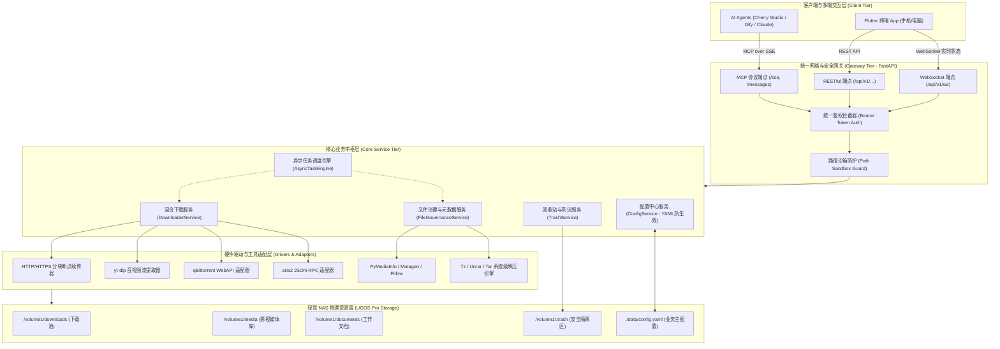

# Nasio（绿联 NAS 智能中枢与资产管家）
## 总体技术架构与功能详细设计文档

---

## 1. 项目重构定位与产品全景

### 1.1 项目新定位
本项目原名 `nas-ai-mcp`，现正式全面升级重构为：**`Nasio`（中文名：绿联 NAS 智能中枢与资产管家）**。

- **过去定位**：单一的 Model Context Protocol (MCP) 接口服务。
- **现在定位**：专为私有 NAS（优先适配绿联 UGOS / UGOS Pro）打造的**一体化智能数字资产中枢平台**。
  - **核心底层**：统一调度 NAS 本地文件系统、流媒体解析、回收站防灾、aria2/qBittorrent 外部下载器。
  - **交互上层（双轮驱动）**：
    1. **MCP 子系统 (AI 开放赋能通道)**：暴露标准 Tools，使第三方 AI Agent（Cherry Studio、Dify、Claude 等）具备调度 NAS 的能力；
    2. **Flutter 跨平台客户端 (可视化管理中枢)**：提供 iOS / Android / macOS / Windows 统一的多端控制台，实现可视化运维、配置热加载、任务实时看板与回收站管理。

```
+-------------------------------------------------------------------------------------------------+
|                               Nasio 产品生态全景                                          |
+-------------------------------------------------------------------------------------------------+
|                                                                                                 |
|   +---------------------------------------+       +-----------------------------------------+   |
|   |            AI 智能体生态              |       |        Flutter 跨平台控制台             |   |
|   |   (Cherry Studio / Dify / Claude)     |       |   (iOS / Android / macOS / Windows)     |   |
|   +-------------------+-------------------+       +--------------------+--------------------+   |
|                       |                                                |                        |
|                       | MCP over SSE                                   | RESTful API            |
|                       | (AI Tool Callings)                             | & WebSocket            |
|                       v                                                v                        |
|   +-----------------------------------------------------------------------------------------+   |
|   |                        Nasio Server (绿联 NAS Docker 容器)                        |   |
|   |                                                                                         |   |
|   |   ┌─────────────────────────────────────────────────────────────────────────────────┐   |   |
|   |   │                        统一网关层 (FastAPI Gateway)                             │   |   |
|   |   │        - 统一 Bearer Token 鉴权       - 路径沙箱隔离 (Sandbox)                  │   |   |
|   |   │        - /sse (MCP 路由)              - /api/v1 (RESTful 路由 & WebSocket)      │   |   |
|   |   └────────────────────────────────────────┬────────────────────────────────────────┘   |   |
|   |                                            │                                            |   |
|   |   ┌────────────────────────────────────────▼────────────────────────────────────────┐   |   |
|   |   │                         核心业务服务层 (Core Services)                          │   |   |
|   |   │   - 混合下载服务 (Downloader)        - 文件治理与元数据 (FileManager & Meta)    │   |   |
|   |   │   - 回收站与防灾 (Trash & Safe)      - 动态配置引擎 (Config hot-reload)         │   |   |
|   |   │   - 异步长任务调度器 (TaskEngine)                                               │   |   |
|   |   └────────────────────────────────────────┬────────────────────────────────────────┘   |   |
|   +--------------------------------------------|--------------------------------------------+   |
|                                                |                                                |
|                                                v                                                |
|   +-----------------------------------------------------------------------------------------+   |
|   |                        绿联 NAS 物理硬件与外部生态系统                                  |   |
|   |                                                                                         |   |
|   |   - 本地存储池 (/volume1/downloads, /volume1/media, /volume1/.trash)                    |   |
|   |   - 外部下载器集群 (宿主机 qBittorrent, aria2 RPC)                                      |   |
|   |   - 媒体服务集成 (Infuse, Jellyfin, Emby 刮削协同)                                      |   |
|   +-----------------------------------------------------------------------------------------+   |
+-------------------------------------------------------------------------------------------------+
```

---

## 2. 总体技术架构设计

### 2.1 分层架构蓝图



### 2.2 技术栈全景

| 层次 | 选型组件 | 核心职责 |
| :--- | :--- | :--- |
| **服务端框架** | Python 3.11 + FastAPI + FastMCP | 高性能异步 I/O，同时支撑 MCP 协议与 REST/WebSocket |
| **任务与并发** | Python `asyncio` + 线程池 / 进程池 | 处理直链多线程下载、全盘查重、大包解压等长耗时操作 |
| **外部生态联动** | `aria2p`、`qbittorrent-api`、`yt-dlp` | 深度集成 BT/磁力下载、网页视频流嗅探与外部下载器管控 |
| **多媒体与文档** | `pymediainfo`、`mutagen`、`Pillow` | 免索引数据库，秒级深挖视频音轨/分辨率、音频 ID3、图片 EXIF |
| **系统底层支持** | Debian Bookworm + `gosu` + `ffmpeg` + `p7zip` | 保证媒体解码、RAR5/7z 解压，利用 `gosu` 实现 NAS PUID/PGID 权限穿透 |
| **移动与桌面端** | **Flutter 3.x (Dart)** | 构建跨平台客户端，负责配置管理、看板监控与一键还原 |

---

## 3. 子系统功能详细设计

### 3.1 核心服务一：配置中心（ConfigService）
支持 **三级配置模型**，保证开箱即用与动态热更新并存：
1. **基线层（Docker ENV）**：配置安全密钥 `MCP_AUTH_TOKEN`、容器权限 `PUID`/`PGID`、服务端口。
2. **业务层（`config.yaml` 挂载）**：集中维护存储白名单、回收站配额、下载器账号密码、并发限速规则。服务通过文件监听实现**毫秒级热加载（Hot-Reload）**，免重启容器。
3. **交互层（REST & MCP 映射）**：
   - 暴露 `GET/PUT /api/v1/config` 给 Flutter 端渲染表单与一键修改。
   - 暴露 `get_mcp_config` 工具给 AI 客户端查询环境约束。

### 3.2 核心服务二：回收站与安全防灾（TrashService）
- **软删除设计**：任何删除指令默认拦截为软删除，规整化移至 `/volume1/.trash/{YYYY-MM-DD}/{UUID}_{name}`。
- **元数据追踪**：同步维护 `.meta.json` 索引，记录文件的原始路径、删除时间、发起者（AI 或 用户手动）、文件大小。
- **防灾与自愈能力**：
  - 支持 **一键原路还原**：无论目录是否被移动，系统均能通过记录重建原目录树并原样移回。
  - 支持 **生命周期清理策略**：支持按时间（如保留 30 天）或按体积（如最大 100GB）滚动清理最老旧的软删除文件。
- **预演机制（Dry-Run）**：所有文件重组、批量改名强制支持试运行预览，输出变更前后的完整 Diff。

### 3.3 核心服务三：混合下载调度中心（DownloaderService）
- **智能协议路由**：
  - `http://`、`https://`：调用内置异步多线程分块下载器（支持断点续传）；
  - 网页流媒体（Bilibili、YouTube、播客）：路由至内置 `yt-dlp`，支持提取最高画质或纯音频转码；
  - `magnet:` 磁力链与 `.torrent`：自动路由至 NAS 宿主机或同局域网的 `qBittorrent` / `aria2`。
- **健康自检（Diagnostics）**：
  - 内置探测器，定期或按需检测外部 qB/aria2 的连通性、网络延时及可用空间。

### 3.4 核心服务四：文件治理与深度元数据（FileGovernanceService）
- **极速多维检索**：按通配符、正则、扩展名、修改日期区间、文件体积区间组合过滤，限制最大深度防死循环。
- **三级过滤漏斗查重算法**：
  - 1级：文件物理体积精准初筛（过滤 95% 以上不同文件）；
  - 2级：首尾 4KB 局部快速 Hash 计算；
  - 3级：仅对完全疑似相同的极少数文件执行全量 SHA256 最终确权。
- **媒体深度透视**：提取 4K/HDR/编码格式/音轨字幕/相机拍摄参数/文本前缀摘要。
- **系统级智能解压**：利用底层 p7zip 与 unrar-free，支持修复 Windows ZIP 中文文件名乱码问题。

---

## 4. MCP 子系统：AI 开放能力清单 (Tools)

MCP 模块充当系统的“AI 转换器”，向 Cherry Studio、Dify 等智能体暴露以下标准工具：

| 工具分类 | 工具标识 (Tool Name) | 功能概述 | 执行模式 |
| :--- | :--- | :--- | :--- |
| **系统与运维** | `get_system_status` | 获取存储池余量、CPU/内存负载、活跃任务数 | 同步直返 |
| | `get_mcp_config` | 查看当前生效的目录白名单与下载器挂载状态 | 同步直返 |
| | `test_downloader_connection`| 诊断外部 qB / aria2 连通状态 | 同步直返 |
| **异步任务管控** | `get_task_status` | 根据 `task_id` 查询大任务进度百分比与当前速度 | 同步直返 |
| | `cancel_task` | 中断取消正在进行的后台下载或查重任务 | 同步直返 |
| **下载引擎** | `create_download_task` | 提交直链、视频网页或磁力链下载（智能路由） | **异步派发** (返回 task_id) |
| **文件检索** | `search_files` | 多条件组合文件实时检索 | 同步直返 |
| | `get_file_metadata` | 深度解析音视频编码、图片 EXIF、文档前缀 | 同步直返 |
| | `list_directory_tree` | 目录树层级轻量速览 | 同步直返 |
| **文件治理** | `batch_organize_files` | 按扩展名/日期/命名规则智能归档（支持 dry_run）| 同步/长任务可选 |
| | `batch_rename_files` | 批量正则与模板重命名（支持 dry_run） | 同步直返 |
| | `find_duplicate_files` | 漏斗哈希极速全盘查重 | **异步派发** (返回 task_id) |
| | `extract_archive` | 解压 zip/rar/7z（自动修复中文乱码） | **异步派发** (返回 task_id) |
| **回收站管理** | `safe_delete_files` | 软删除文件/目录至 `.trash` | 同步直返 |
| | `list_trash_files` | 检索/浏览回收站已删除项目 | 同步直返 |
| | `restore_trash_file` | 一键将回收站文件原路恢复 | 同步直返 |

---

## 5. REST & WebSocket 子系统：Flutter 客户端管理接口规范

面向后续自研的 **Flutter 跨平台客户端**，统一网关开放以下 RESTful API 与实时通道：

### 5.1 基础运维与配置管理 (`/api/v1/config`)
- `GET /api/v1/config`
  - 返回脱敏后的完整业务配置（白名单目录数组、回收站保留天数与限额、qBittorrent Host 与账号、限速设置）。
- `PUT /api/v1/config`
  - 接收 Flutter 表单提交的新配置，校验路径合法性后安全原子写入 `config.yaml`，触发系统内部组件热刷新。
- `POST /api/v1/config/whitelist/add`
  - 便捷添加单个白名单目录，后端自动探测宿主机挂载点是否存在。

### 5.2 回收站运维面板 (`/api/v1/trash`)
- `GET /api/v1/trash?page=1&limit=20&keyword=xxx`
  - 分页返回回收站文件列表（包含删除时间、原始路径、文件大小、删除原因）。
- `POST /api/v1/trash/{file_id}/restore`
  - 在客户端点击“还原”，服务端恢复原路并返回成功提示。
- `DELETE /api/v1/trash/{file_id}`
  - 永久抹除单个文件。
- `DELETE /api/v1/trash`
  - 清空回收站（二次确认后执行）。

### 5.3 外部下载器管理 (`/api/v1/downloaders`)
- `POST /api/v1/downloaders/test`
  - 触发即时连通性测试，返回目标下载器版本号、网络延迟及鉴权状态。
- `GET /api/v1/downloaders/summary`
  - 返回下载器当前正在下载的种子总数、上传/下载即时速率。

### 5.4 实时任务看板与 WebSocket (`/api/v1/tasks`)
- `GET /api/v1/tasks`
  - 获取正在运行与近期完成的下载/解压/查重任务列表。
- `WS /api/v1/tasks/ws`
  - **WebSocket 实时推送通道**：
    - 客户端连接后，服务端以 500ms 周期广播活动任务的即时动态：
    ```json
    {
      "event": "TASK_PROGRESS",
      "data": {
        "task_id": "dl_1024",
        "progress": 78.4,
        "speed": "14.6 MB/s",
        "downloaded_bytes": 3221225472,
        "total_bytes": 4108849152,
        "eta_seconds": 60
      }
    }
    ```
    - Flutter 端收到事件后实时驱动进度条动画与下载速率曲线图。

---

## 6. 绿联 NAS 容器化部署方案

### 6.1 代码工程目录组织
```
Nasio/
├── docker/
│   ├── Dockerfile
│   └── entrypoint.sh             # PUID/PGID 降权与权限穿透脚本
├── data/
│   └── config.yaml               # 业务配置主文件 (挂载映射)
├── src/
│   └── nasio/
│       ├── __init__.py
│       ├── main.py               # FastAPI 与 FastMCP 启动入口
│       ├── core/                 # 核心基础库 (配置加载/沙箱校验/安全模型)
│       ├── services/             # 业务服务实现
│       │   ├── config_service.py
│       │   ├── trash_service.py
│       │   ├── downloader_service.py
│       │   ├── file_service.py
│       │   └── task_engine.py
│       ├── mcp/                  # MCP 协议路由与 Tools 注册
│       │   └── server.py
│       └── api/                  # RESTful 控制器与 WebSocket 路由
│           ├── v1_config.py
│           ├── v1_trash.py
│           ├── v1_tasks.py
│           └── v1_downloaders.py
├── docker-compose.yml
└── requirements.txt
```

### 6.2 绿联 NAS Docker-Compose 部署模版

```yaml
version: '3.8'

services:
  Nasio:
    image: Nasio:latest
    container_name: Nasio
    restart: unless-stopped
    ports:
      - "8000:8000"              # MCP SSE 协议与 REST/WS 共用同一网关端口
    environment:
      # 核心访问令牌 (AI 客户端与 Flutter 客户端共用)
      - MCP_AUTH_TOKEN=your_secure_random_token_here
      # 绿联 NAS 管理员 UID/GID 权限映射 (解决文件 root 锁死痛点)
      - PUID=1000
      - PGID=1000
      # 宿主机时区对齐
      - TZ=Asia/Shanghai
    volumes:
      # 业务配置文件与持久化数据挂载
      - ./data:/app/data
      # 绿联 NAS 本地存储池挂载
      - /volume1/downloads:/volume1/downloads
      - /volume1/media:/volume1/media
      - /volume1/documents:/volume1/documents
      - /volume1/.trash:/volume1/.trash
    deploy:
      resources:
        limits:
          cpus: '2.0'
          memory: 2048M
```

---

## 7. 后续规划：Flutter 客户端演进蓝图

1. **第一阶段：运维看板（Dashboard）**
   - 登录连接 NAS（安全存储 NAS 地址与 Token）。
   - 存储池容量与 CPU 负载可视化展示。
   - 动态修改与扩展目录白名单。
2. **第二阶段：文件管理与回收站控制（File & Trash Hub）**
   - 回收站浏览、过滤与一键原路恢复。
   - 外部 qBittorrent 连通性测试与配置。
   - WebSocket 实时下载监控卡片。
3. **第三阶段：原生 AI 对话管家（Built-in AI Assistant UI）**
   - 在 Flutter 应用内直接内嵌 AI 聊天窗口。
   - 手机端直接给 AI 语音或打字下达 NAS 整理与下载指令，无需跳转第三方软件，体验彻底闭环。
